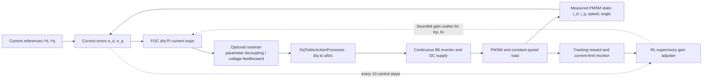

# Method Draft: RL-Assisted PMSM FOC Current Control

**Status:** Initial method draft based on Gym Electric Motor (GEM) 3.0.3 docs and a local interface check. Controller details and numerical settings are provisional until the PI baseline is implemented and validated.

## Control architecture

The base environment is `Cont-CC-PMSM-v0`. It provides an abc-domain continuous-action PMSM simulation and references for `i_sd` and `i_sq`. Its native action has three components for the three-phase converter. The tested GEM `DqToAbcActionProcessor` wrapper changes the action interface to two normalized d/q voltage commands and performs the rotor-angle-dependent coordinate conversion into abc actions. Thus, the proposed FOC PI controller outputs d/q voltages; it does not output inverter phase commands directly.

## Proposed method

The electrical plant is the default GEM `PermanentMagnetSynchronousMotor`, supplied by a 300 V ideal DC source and connected to the default constant-speed load. The installed model reports the nominal parameters `R_s = 0.018 Ω`, `L_d = 0.37 mH`, `L_q = 1.2 mH`, permanent-magnet flux linkage `ψ_p = 0.066 Wb`, and three pole pairs. The nominal control period is `100 μs` (10 kHz). Observations contain normalized physical-system states and normalized references; the underlying state names include `i_sd`, `i_sq`, electrical angle `epsilon`, and the three phase currents and voltages. We will use `i_sd*` and `i_sq*` as the inner-loop references, with `i_sd* = 0` as the initial operating choice.

The baseline is a conventional d/q PI current controller. Each current error is processed by its PI controller to produce a voltage command, subject to the same voltage and current limits for every method. Nominal-parameter cross-coupling/back-EMF feedforward may be included, but it must be identical in both methods; first validate the simpler PI loop, then add the feedforward if needed for a sound baseline.

The proposed RL agent is a supervisory tuner, not a replacement for the PI loops. Its observation will include normalized d/q current errors, measured d/q currents, speed, and the previous gain scales. At a slower interval (initially one RL decision every 10 motor-control samples, i.e. 1 ms), it will output bounded scale adjustments for the d/q proportional and integral gains. The scales will be clipped to a conservative interval around the stable baseline gains and rate-limited. An off-policy continuous-action algorithm such as SAC is a candidate, subject to the existing baseline and a short training feasibility check.

Training reward will primarily penalize squared d/q current-tracking errors, with smaller penalties for gain changes and violations of safety limits. Evaluation will compare fixed PI and RL-assisted PI under identical reference trajectories, plant settings, action limits, and random seeds. The primary metric is d/q current RMSE; overshoot, settling time, IAE, limit activations, and unstable runs are secondary metrics. Parameter-mismatch evaluation will change plant `R_s` and/or `L_d`, `L_q` while retaining nominal controller design values.

## Verification notes and cautions

- Local package version: `gym-electric-motor 3.0.3`.
- A local smoke test confirmed native action shape `(3,)`; adding `DqToAbcActionProcessor.make('PMSM')` changes it to `(2,)`, and a d/q action completes an environment step.
- The online GEM reference page is older than the installed package and its listed state names differ slightly from the local 3.0.3 model. Use the installed version for code and record exact configuration in experiments.
- GEM Control is a separate official project; its README demonstrates an automatically tuned PI controller on `Cont-TC-PMSM-v0` (torque-control environment). That is useful as a controller reference, but it is not evidence that our selected current-control environment already contains this project's FOC/PI implementation.
- Before RL training, implement and verify the fixed-PI path, reference steps, voltage/current limits, and logged physical-unit signals. Keep the RL sampling interval, gain ranges, reward weights, and feedforward choice provisional until this test passes.

## Official references

- GEM PMSM continuous current-control environment: <https://upb-lea.github.io/gym-electric-motor/parts/environments/pmsm/cont_cc_pmsm.html>
- GEM core observation/action model: <https://upb-lea.github.io/gym-electric-motor/parts/core.html>
- GEM source and examples: <https://github.com/upb-lea/gym-electric-motor>
- `DqToAbcActionProcessor` is included in the GEM source package under `gym_electric_motor/physical_system_wrappers/`.
- GEM Control examples: <https://github.com/upb-lea/gem-control>
